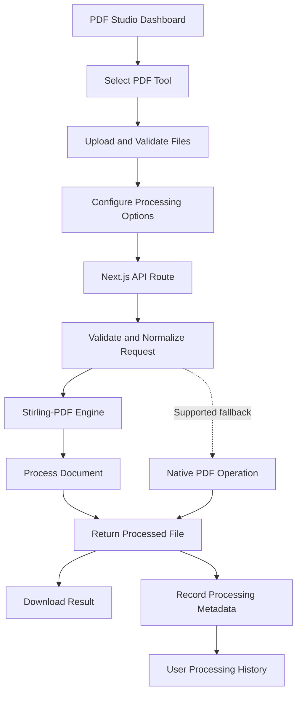
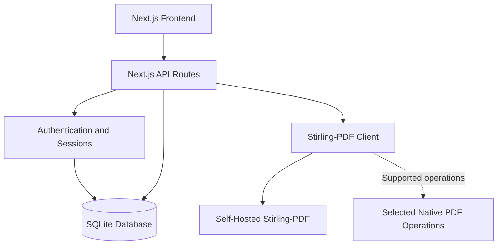

 <div align="center">

# PDF Studio

### Powerful PDF Processing. Private Infrastructure. Seamless Workflows.

A modern, self-hosted PDF processing platform built with Next.js, TypeScript, and Stirling-PDF — combining an intuitive document workspace, secure user accounts, persistent processing history, and a modular architecture.

<br/>

<a href="#getting-started">
  
</a>
<a href="#architecture">
  
</a>

<br/><br/>


<br/><br/>

**Private by design. Powerful by default. Built for modern document workflows.**

</div>

---

## 01 — Project Overview

PDF Studio is a full-stack PDF manipulation suite designed to bring essential document-processing tools into one streamlined, self-hosted application.

Powered by [Stirling-PDF](https://github.com/Stirling-Tools/Stirling-PDF), the platform combines a modern web interface with a server-side API proxy, persistent SQLite storage, and authenticated user workflows.

Rather than treating every PDF operation as a separate utility, PDF Studio organizes document processing around a unified dashboard, dedicated tool workspaces, consistent upload experiences, and a centralized history system.

<table>
<tr>
<td width="50%" valign="top">

**Document Processing**

Merge, split, rotate, compress, convert, protect, and OCR documents through dedicated processing workflows.

</td>
<td width="50%" valign="top">

**Modern Workspace**

Explore categorized tools through a responsive dashboard, searchable tool catalog, and reusable interface components.

</td>
</tr>
<tr>
<td width="50%" valign="top">

**Accounts & History**

Manage user accounts, authenticated sessions, processing records, and account-specific activity.

</td>
<td width="50%" valign="top">

**Self-Hosted Infrastructure**

Connect the frontend to a self-hosted PDF engine through a server-side proxy, keeping processing infrastructure under your control.

</td>
</tr>
</table>

### Core Principles

- **Privacy first** — Keep document processing within infrastructure you control.
- **One consistent workspace** — Use a unified interface for different PDF operations.
- **Secure by design** — Protect account credentials and enforce user-specific access controls.
- **Modular architecture** — Separate processing logic, authentication, database access, and interface components.
- **Operational clarity** — Provide processing states, useful errors, and downloadable results.

> **Privacy note:** Self-hosting improves control over document handling, but actual privacy depends on deployment configuration, temporary-file cleanup, logging, backups, and any external services used by the processing engine.

---

## 02 — Visual Showcase

<div align="center">

<!-- Add screenshots of the actual application here. -->

<!--

-->

*Add a high-resolution screenshot of the PDF Studio dashboard here.*

</div>

PDF Studio is organized around three complementary experiences:

- **Discover:** Find the right tool through categories, search, and the dashboard.
- **Process:** Upload documents, configure operation-specific settings, and monitor processing.
- **Manage:** Review processing history, access account settings, and manage saved activity.

A consistent visual system connects these experiences through shared navigation, reusable components, and responsive layouts.

---

## 03 — Core Capabilities

### Document Processing

PDF Studio brings common document operations into one interface.

| Tool | Function |
|---|---|
| Merge PDF | Combine multiple documents in a selected order |
| Split PDF | Extract pages using configurable page ranges |
| Rotate PDF | Rotate pages by 90°, 180°, or 270° |
| PDF to Word | Convert PDF documents into editable Word files |
| Image to PDF | Combine images into a PDF document |
| Compress PDF | Reduce document size using supported compression settings |
| Add Password | Apply supported PDF password protection |
| OCR PDF | Recognize text in scanned documents using supported languages |

Processing options and output formats depend on the configured Stirling-PDF version and the capabilities of the relevant endpoint.

### Dashboard & Interface

- Responsive dashboard with categorized tool discovery.
- Searchable tool catalog and keyboard-accessible command palette.
- Drag-and-drop file uploads with validation and reordering.
- Dedicated workspaces for individual PDF tools.
- Processing states and actionable error messages.
- Downloadable processing results.
- Light, dark, and system theme support.
- Responsive navigation and reusable interface primitives.

### Accounts & Processing History

- User registration and sign-in.
- Bcrypt-based password hashing.
- Secure session-cookie management.
- User-specific processing history.
- Account management and session overview.
- History inspection and deletion controls.

### Infrastructure & Reliability

- Self-hosted Stirling-PDF integration.
- Server-side Next.js API proxy.
- SQLite-backed application metadata.
- Validated tool parameters and normalized errors.
- Native PDF processing fallbacks for selected operations.
- Automated unit and integration tests.
- Docker-based deployment for the application and PDF engine.

---

## 04 — Processing Workflow

PDF Studio separates the user-facing workflow from the underlying document-processing engine.



### How It Works

1. The user selects a tool from the dashboard.
2. The interface collects files and operation-specific settings.
3. The browser submits the request to the corresponding Next.js API route.
4. The server validates the request and forwards it to the configured PDF engine.
5. Stirling-PDF processes the document and returns the result.
6. The server handles the response and exposes the processed file for download.
7. Eligible processing metadata is recorded for the authenticated user.

The processing engine remains behind the server-side proxy rather than requiring the browser to communicate directly with the internal service.

History recording and file retention should be handled separately: the application can retain processing metadata without intentionally storing completed document contents as permanent user files.

---

## 05 — Architecture

PDF Studio uses a modular application structure to keep interface code, authentication, persistence, and document-processing logic separate.



### Technology Stack

| Layer | Technology |
|---|---|
| Framework | Next.js 16 — App Router |
| Language | TypeScript — Strict Mode |
| Styling | Tailwind CSS v4 |
| UI primitives | Radix UI |
| Icons | Lucide React |
| Motion | Framer Motion and CSS transitions |
| Database | SQLite with `@libsql/client` |
| Authentication | `bcryptjs` and secure session cookies |
| PDF processing | Stirling-PDF and selected `pdf-lib` fallbacks |
| Theme management | `next-themes` |
| Notifications | Sonner |
| Validation | Zod |
| Testing | Node.js Test Runner and `tsx` |
| Deployment | Docker and Docker Compose |

### Architectural Responsibilities

**Frontend:** Renders the dashboard, upload interface, tool workspaces, account pages, and processing feedback.

**API layer:** Validates incoming requests, applies access controls, forwards processing requests, and handles file responses.

**Processing client:** Centralizes Stirling-PDF endpoint configuration, request construction, response handling, and error normalization.

**Database layer:** Stores application metadata, user records, session information, and processing history.

**Native fallbacks:** Provide alternative implementations for selected operations where explicitly supported by the application.

---

## 06 — Project Structure

The application separates routes, interface components, configuration, persistence, authentication, and PDF processing.

```text
pdf-studio/
├── app/
│   ├── api/
│   │   ├── auth/
│   │   │   ├── login/route.ts
│   │   │   ├── logout/route.ts
│   │   │   ├── me/route.ts
│   │   │   └── register/route.ts
│   │   ├── health/route.ts
│   │   ├── history/route.ts
│   │   └── tools/[slug]/route.ts
│   ├── account/page.tsx
│   ├── help/page.tsx
│   ├── history/page.tsx
│   ├── login/page.tsx
│   ├── privacy/page.tsx
│   ├── register/page.tsx
│   ├── terms/page.tsx
│   ├── tools/[slug]/page.tsx
│   ├── globals.css
│   ├── layout.tsx
│   ├── not-found.tsx
│   └── page.tsx
├── components/
│   ├── dashboard/
│   ├── layout/
│   ├── tools/
│   └── ui/
├── config/
│   ├── site.ts
│   └── tools.ts
├── lib/
│   ├── auth/
│   │   ├── password.ts
│   │   └── session.ts
│   ├── db/
│   │   └── index.ts
│   ├── stirling/
│   │   ├── client.ts
│   │   ├── download.ts
│   │   ├── endpoints.ts
│   │   ├── errors.ts
│   │   ├── native-fallback.ts
│   │   └── schemas.ts
│   └── utils.ts
├── tests/
│   ├── integration/
│   │   └── api-tools.test.ts
│   └── unit/
│       ├── auth-db.test.ts
│       ├── stirling-client.test.ts
│       └── tools.test.ts
├── data/
│   └── .gitkeep
├── Dockerfile
├── docker-compose.yml
├── DEPLOYMENT.md
├── package.json
└── README.md
```

*This is a compact representation of the documented structure. Update it to reflect the actual files in your repository.*

---

## 07 — PDF Tool Catalog

The dashboard groups document tools by their primary purpose.

| Tool | Category | Documented API Endpoint |
|---|---|---|
| Merge PDF | Organize | `/api/v1/general/merge-pdfs` |
| Split PDF | Organize | `/api/v1/general/split-pages` |
| Rotate PDF | Organize | `/api/v1/general/rotate-pdf` |
| PDF to Word | Convert | `/api/v1/convert/pdf/word` |
| Image to PDF | Convert | `/api/v1/convert/img/pdf` |
| Compress PDF | Optimize | `/api/v1/misc/compress-pdf` |
| Add Password | Security | `/api/v1/security/add-password` |
| OCR PDF | OCR | `/api/v1/misc/ocr-pdf` |

**API compatibility:** Verify endpoint paths, HTTP methods, multipart field names, processing options, and response formats against the exact Stirling-PDF version you deploy. The table reflects the documented configuration, not a guarantee that every endpoint remains unchanged across releases.

### Tool Integration Design

The processing integration is organized into dedicated modules:

- `client.ts` — Coordinates requests to the configured PDF engine.
- `endpoints.ts` — Centralizes endpoint definitions.
- `schemas.ts` — Defines supported parameters and validation.
- `errors.ts` — Normalizes processing failures.
- `download.ts` — Handles processed-file responses.
- `native-fallback.ts` — Contains selected alternative processing paths.

This separation helps keep endpoint-specific behavior out of individual UI components.

---

## 08 — Getting Started

### Requirements

- Node.js version compatible with your installed Next.js release.
- npm.
- Git.
- Docker and Docker Compose for containerized deployment.
- A configured Stirling-PDF instance.

### 1. Clone the Repository

```bash
git clone <your-repository-url>
cd pdf-studio
```

Replace `<your-repository-url>` with the URL of your actual repository.

### 2. Install Dependencies

```bash
npm install
```

### 3. Configure Environment Variables

Create a local `.env` file using the variable names supported by your application.

For example:

```dotenv
NODE_ENV=development
STIRLING_PDF_URL=http://localhost:8080
DATABASE_URL=file:./data/pdf-studio.db
```

These values are illustrative. Check the implementation in `lib/db/index.ts`, `lib/stirling/client.ts`, and `docker-compose.yml` to confirm the exact variable names and connection configuration.

Never commit production credentials, session secrets, or other sensitive values to version control.

### 4. Start the Development Server

```bash
npm run dev
```

Open [http://localhost:3000](http://localhost:3000).

Ensure that Stirling-PDF is also running and reachable at the configured internal URL before testing processing operations.

### 5. Run Quality Checks

```bash
npm test
npm run lint
npm run build
```

Run each command independently and resolve failures before deploying. The available commands depend on your `package.json` scripts.

### 6. Build for Production

```bash
npm run build
npm start
```

---

## 09 — Docker Deployment

PDF Studio can be deployed alongside Stirling-PDF using Docker Compose.

### Start the Services

```bash
docker compose up -d --build
```

### Inspect the Deployment

```bash
docker compose ps
docker compose logs -f
```

### Service Overview

| Service | Example Address | Responsibility |
|---|---|---|
| PDF Studio | `http://localhost:3000` | Web interface and API |
| Stirling-PDF | `http://localhost:8080` | PDF processing engine |
| Health endpoint | `/api/health` | Application health reporting |

The actual addresses depend on the port mappings and service definitions in your Compose configuration.

Inside a Docker network, the application should connect to Stirling-PDF through its configured service hostname when supported by the deployment, rather than relying on a container's `localhost`.

### Production Recommendations

- Keep the PDF engine on a private network where possible.
- Configure persistent storage for application data.
- Protect environment variables and service credentials.
- Set appropriate CPU, memory, and upload limits.
- Configure health checks and restart policies.
- Review temporary-file cleanup and retention settings.
- Terminate public HTTPS traffic through a properly configured reverse proxy or hosting platform.

For additional deployment instructions, see [`DEPLOYMENT.md`](DEPLOYMENT.md).

---

## 10 — Authentication & Data Management

PDF Studio includes an account system designed to keep processing history associated with the appropriate user.

### Authentication

- Bcrypt-based password hashing.
- Session-cookie management.
- Registration, sign-in, and logout routes.
- Session inspection through the authenticated account interface.
- Protected account-specific operations.

### Processing History

The history system provides a persistent record of eligible document-processing activity.

- Inspect individual processing records.
- Review previous tool usage.
- Access available file and operation metadata.
- Delete selected history records.
- Keep records isolated between authenticated users.

Processing history should store only the metadata needed by the application. If processed documents are not intended to be permanently stored, temporary files should be cleaned up independently of the history records.

### Database Operations

The SQLite integration is responsible for application metadata and account-related persistence.

Recommended operational practices include:

- Keep database files outside publicly served directories.
- Use controlled schema migrations.
- Back up persistent data regularly.
- Restrict database filesystem permissions.
- Verify restore procedures.
- Avoid storing unnecessary document contents or sensitive processing details in logs.

---

## 11 — Security & Privacy

Security is an essential part of a self-hosted document-processing platform.

| Area | Recommended Approach |
|---|---|
| Password storage | Bcrypt hashing; never store plaintext passwords |
| Sessions | Protected cookies, expiration, and logout invalidation |
| Authorization | Enforce per-user access controls on protected API routes |
| Input validation | Validate parameters, page ranges, and file metadata |
| Upload security | Enforce file-size and request limits |
| PDF engine | Private service networking where practical |
| Temporary files | Controlled retention and cleanup |
| Database | Restricted filesystem access and regular backups |
| Production traffic | HTTPS and appropriate secure-cookie settings |
| Secrets | Environment-based configuration and secure secret management |

PDF files may contain sensitive information. Review logging, temporary storage, OCR dependencies, conversion components, backups, and any external integrations before processing confidential documents.

Self-hosting gives operators more control, but it does not automatically guarantee confidentiality or eliminate all security risks.

---

## 12 — Testing & Quality Assurance

The documented test suite covers unit-level behavior and API integration.

| Test Suite | Coverage |
|---|---|
| `auth-db.test.ts` | Authentication and database operations |
| `stirling-client.test.ts` | PDF engine client behavior |
| `tools.test.ts` | Tool configuration and validation |
| `api-tools.test.ts` | Tool API integration |

### Run Tests

```bash
npm test
```

The documented test plan contains 21 automated unit and integration tests. Confirm the actual test count and passing results against the current repository and CI output before presenting them as verified release statistics.

### Recommended Verification Areas

- Authentication and session expiration.
- User-specific history isolation.
- Upload validation and file-size limits.
- Correct multipart request construction.
- Stirling-PDF endpoint compatibility.
- Processing failures and normalized error responses.
- Downloaded file handling.
- Native fallback behavior.
- Temporary-file cleanup.
- Production build and Docker startup.

---

## 13 — Performance & Reliability

PDF processing workloads vary significantly depending on document size, page count, image complexity, OCR requirements, and available resources.

PDF Studio's architecture supports operational improvements through:

- Reusable API clients and centralized endpoint definitions.
- Validated processing options.
- Normalized error handling.
- Dedicated processing-state components.
- Explicit upload and request limits.
- Container resource configuration.
- Health checks and structured logging.
- Automated regression testing.

For resource-intensive tasks, consider request timeouts, concurrency limits, temporary-storage monitoring, and asynchronous processing queues as the application evolves.

---

## 14 — Roadmap

Potential areas for continued development:

- [ ] Expand the PDF tool catalog.
- [ ] Add batch-processing workflows.
- [ ] Improve document preview capabilities.
- [ ] Introduce configurable processing limits.
- [ ] Enhance accessibility and localization.
- [ ] Expand processing diagnostics and operational metrics.
- [ ] Add automated CI checks for linting, tests, and production builds.
- [ ] Improve handling of resource-intensive processing jobs.
- [ ] Strengthen integration and security testing.

*Roadmap items represent potential improvements and should not be interpreted as already implemented functionality.*

---

## 15 — Contributing

Contributions, bug reports, and practical improvements are welcome.

1. Fork the repository.
2. Create a dedicated feature branch.
3. Implement your changes using the project's TypeScript conventions.
4. Add or update tests where appropriate.
5. Run the test, lint, and build commands.
6. Open a pull request explaining the change and verification performed.

For larger changes, open an issue first to discuss the proposed implementation.

Please avoid including credentials, confidential documents, session tokens, or sensitive processing data in issues and logs.

---

## 16 — License

Add the license applicable to your repository and include the corresponding `LICENSE` file before publishing.

Review the licensing terms of third-party dependencies and the deployed PDF processing engine separately.

---

<div align="center">

### PDF Studio

**A cleaner, more private way to work with PDF documents.**

<br/>

Built with Next.js, TypeScript, SQLite, and Stirling-PDF.

<br/>

<sub>Self-host your tools. Streamline your workflow. Stay in control.</sub>

</div>
